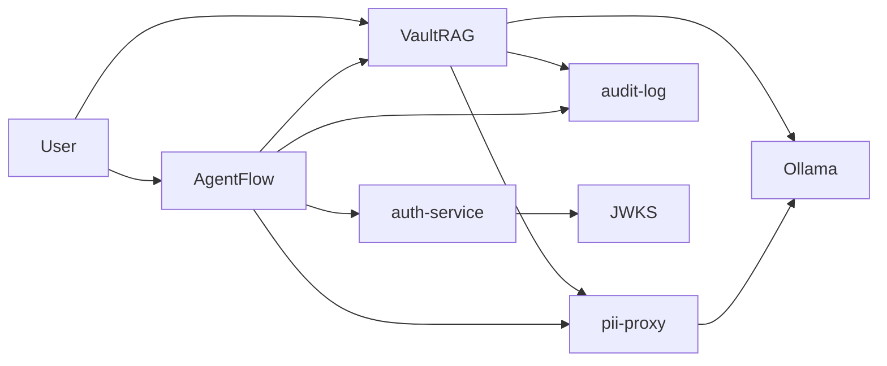

# AISecurity4Fintech

**AI for regulated finance that provably never leaks personal data, never acts
outside its authority, and never loses the evidence.**

A working reference platform — not a slide deck — for running large language
models over sensitive documents and customer interactions. Two applications sit
behind one security layer:

- **VaultRAG** — secure retrieval-augmented generation with citations, for
  compliance and AML analysts.
- **AgentFlow** — a multi-agent support assistant driven by an LLM loop over a
  bounded tool set.

Both share the same primitives: scoped JWTs, a PII-masking proxy, and a
tamper-evident audit log.

## What it proves

Most "AI for finance" demos stop at a prompt. This one closes the three gaps that
actually matter in a regulated setting:

- **Grounding** — answers come from your documents, with citations, so they can
  be verified against the source.
- **Privacy** — PII is masked before it reaches the model; the model never sees
  raw customer data.
- **Accountability** — every decision and action lands in an append-only,
  hash-linked audit log that detects tampering.

And every claim is backed by a test — real redaction regexes, a real hash chain,
real JWKS verification, all run in CI.

## Run the demo

The whole platform runs in one command: five services, two applications, a real
LLM, and a tamper-evident audit trail.

### Prerequisites

- Python 3.12 and [uv](https://docs.astral.sh/uv/)
- [Ollama](https://ollama.com) running locally with two models:
  - `nomic-embed-text` — embeddings
  - `deepseek-v4-pro:cloud` — generation

```bash
ollama pull nomic-embed-text
ollama pull deepseek-v4-pro:cloud
```

### Run it

```bash
make demo
```

### What you'll see

The script starts `auth-service`, `pii-proxy`, `audit-log`, `vaultrag`, and
`agentflow`, then walks the full pipeline:

1. **Ingest** — three realistic documents (a compliance policy, an AML
   procedure, a support runbook, deliberately seeded with PII) are chunked,
   redacted, and embedded. Watch the citations later: they read `IBAN [IBAN]`,
   never the raw account number.
2. **Retrieve** — a support agent asks *"what is the wire transfer threshold?"*
   AgentFlow's LLM-driven loop selects the `retrieve` tool, which queries
   VaultRAG and returns a **cited answer** from the AML procedure.
3. **Act** — the same loop selects `check_balance` and `freeze_card`; the model
   sees each tool's result and writes the final answer. The model only *selects*
   the tool — its arguments are bound to the caller's identity.
4. **Isolate** — a customer asking about another user's balance cannot reach it:
   every action is keyed to their own JWT.
5. **Refuse** — a token without `agent:action` trying to freeze a card gets
   `403 insufficient_scope`.
6. **Verify** — the audit chain is checked and reports `valid=True`.

## Architecture



`pii-proxy` is the only path to the model. Nothing crosses it unmasked.

## The security invariants

1. **No raw PII reaches the model.** Every text is masked by `pii-proxy` before
   it is embedded or sent to the model.
2. **Every sensitive action is audited.** `audit-log` records it in an
   append-only SHA-256 hash chain that detects tampering.
3. **Agents have bounded authority.** Identity is a short-lived, scoped RS256
   JWT; an LLM-driven agent can only *select* from a fixed tool allowlist, never
   parameterise it, and every dispatch is recorded.
4. **Outputs are guarded.** Every generated answer passes a deterministic
   deny-list that blocks system-prompt leaks and jailbreak canaries; a blocked
   output becomes a refusal and is audited.

No compliance claim ships without a test that proves it.

## Applications

### VaultRAG

Secure retrieval-augmented generation over internal documents: chunk → redact →
embed → retrieve → generate a cited answer → audit. Ingest and query both
require scoped JWTs (`vaultrag:ingest` / `vaultrag:query`). See
`apps/vaultrag/README.md`.

### AgentFlow

A multi-agent assistant driven by an LLM loop. The model classifies each request
and selects a tool (`retrieve` / `freeze_card` / `check_balance`); the tool
executes sub-keyed and audited; the model re-reasons with the result until it
produces a final answer. A repeated tool call is refused explicitly (never loops
to the cap), a deterministic output guardrail blocks leaks/canaries, and a
keyword fallback covers model outages. See `apps/agentflow/README.md`.

## Shared services

| Service | What it does |
| --- | --- |
| `auth-service` | Issues short-lived, scoped RS256 JWTs; exposes JWKS |
| `pii-proxy` | Masks PII; stores the reversible mapping in an AES-GCM vault |
| `audit-log` | Append-only, hash-linked, tamper-evident record of actions |

## LLM runtime (Ollama)

The model runs through [Ollama](https://ollama.com), a local inference runtime:

- **Embeddings** — `nomic-embed-text` (local), turns text into vectors.
- **Generation** — `deepseek-v4-pro:cloud`, writes the answers and drives
  AgentFlow's tool selection.

Both are configurable via `OLLAMA_URL` and the `*_EMBED_MODEL` / `*_LLM_MODEL`
settings, so the platform can point at any Ollama without code changes. No PII
ever reaches it: `pii-proxy` masks every text first.

## Repository layout

```
apps/
  vaultrag/      secure retrieval (RAG) for compliance analysts
  agentflow/     LLM-driven multi-agent support orchestration
services/
  auth-service/  RS256 JWT issuance + JWKS
  pii-proxy/     PII masking + encrypted vault
  audit-log/     append-only hash-chain audit
packages/
  py-shared/     settings, logging, tracing
docs/
  adr/           architecture decision records
  threat-model/  security model
  compliance/    compliance mapping
infra/
  docker-compose/  local Postgres/pgvector, Redis, Jaeger
```

## Development

```bash
make test    # full suite with coverage
make lint    # ruff + mypy --strict
make ci      # test + lint + type-check + contract check
make demo    # end-to-end demo (needs Ollama running)
```

Setup needs Python 3.12 and `uv` — see `CONTRIBUTING.md` for the full workflow.

## Status

| Component | State |
| --- | --- |
| `audit-log` | ✅ hash chain (in-memory store) |
| `auth-service` | ✅ RS256 + JWKS |
| `pii-proxy` | ✅ masking + AES-GCM vault (in-memory) |
| `vaultrag` | ✅ ingest + query + redaction + scoped JWT auth (in-memory store) |
| `agentflow` | ✅ LLM-driven agent loop + bounded tools + keyword fallback (in-memory) |

Postgres/pgvector persistence is the next layer: prove the pipeline first, then
persist it.

## Documentation

- `PRD.md` — product requirements and MVP scope (private).
- `docs/adr/` — architecture decisions and their trade-offs.
- `docs/threat-model/v1.md` — the security model every change must respect.

## Principles

- privacy by design
- evidence over opacity
- security controls first, model features second
- simple and understandable
