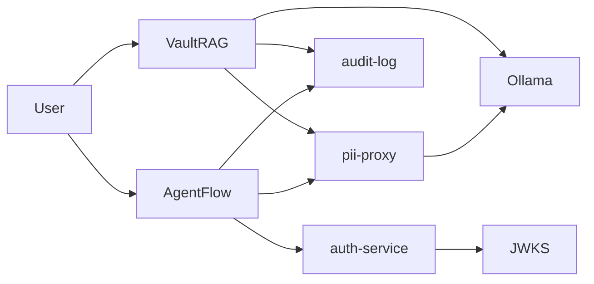

# AISecurity4Fintech

A reference platform for running AI over sensitive documents and customer
interactions **without** leaking personal data, losing control of what the model
does, or losing evidence of what happened.

Two applications share one security layer:

- **VaultRAG** — secure retrieval with citations, for compliance and AML analysts.
- **AgentFlow** — a multi-agent assistant for customer support and operations.

Both sit behind the same primitives: scoped JWTs, a PII proxy, and a
tamper-evident audit log.

## The problem

An LLM answers from what it was trained on. In a regulated setting that is not
enough:

- The model can be wrong and cannot point at the source of a claim.
- It must never see raw customer data.
- Every action it takes must be provable later.

This platform solves those three problems with concrete, tested controls — not
with model-only glue.

## The security invariants

Everything in this repository exists to uphold three rules:

1. **No raw PII reaches the model.** Every text is masked by `pii-proxy` before
   it is embedded or sent to the model.
2. **Every sensitive action is audited.** `audit-log` records it in an
   append-only SHA-256 hash chain that detects tampering.
3. **Agents have bounded authority.** Identity is a short-lived, scoped RS256
   JWT; no agent holds more scope than its task requires.

No compliance claim ships without a test that proves it.

## Architecture



`pii-proxy` is the only path to the model. Nothing crosses it unmasked.

## Applications

### VaultRAG

Secure retrieval-augmented generation over internal documents. Ingest a
document, ask a question, get an answer with citations — with PII redacted
before it ever reaches the model. See `apps/vaultrag/README.md`.

### AgentFlow

A multi-agent assistant for customer support. A supervisor classifies each
request and routes it to a specialized agent with a scoped JWT. See
`apps/agentflow/README.md`.

## Shared services

| Service | What it does |
| --- | --- |
| `auth-service` | Issues short-lived, scoped RS256 JWTs; exposes JWKS |
| `pii-proxy` | Masks PII; stores the reversible mapping in an AES-GCM vault |
| `audit-log` | Append-only, hash-linked, tamper-evident record of actions |

## Repository layout

```
apps/
  vaultrag/      secure retrieval (RAG) for compliance analysts
  agentflow/     multi-agent support orchestration
services/
  auth-service/  RS256 JWT issuance + JWKS
  pii-proxy/     PII masking + encrypted vault
  audit-log/     append-only hash-chain audit
packages/
  py-shared/     settings, logging, tracing
docs/
  adr/           architecture decision records
  threat-model/  security model
  compliance/    compliance mapping
infra/
  docker-compose/  local Postgres/pgvector, Redis, Jaeger
```

## Quick start

```bash
make up      # start Postgres + pgvector, Redis, Jaeger
make test    # full suite with coverage
make demo    # end-to-end VaultRAG demo (needs Ollama running)
make ci      # test + lint + type-check + contract check
```

Setup needs Python 3.12 and `uv` — see `CONTRIBUTING.md`.

## Status

| Component | State |
| --- | --- |
| `audit-log` | ✅ hash chain (in-memory store) |
| `auth-service` | ✅ RS256 + JWKS |
| `pii-proxy` | ✅ masking + AES-GCM vault (in-memory) |
| `vaultrag` | ✅ ingest + query + redaction + audit (in-memory store) |
| `agentflow` | ⚠️ session + scoped JWT only (no agents yet) |

Postgres/pgvector persistence is the next layer: prove the pipeline first, then
persist it.

## Documentation

- `PRD.md` — product requirements and MVP scope (private).
- `docs/adr/` — architecture decisions and their trade-offs.
- `docs/threat-model/v1.md` — the security model every change must respect.

## Principles

- privacy by design
- evidence over opacity
- security controls first, model features second
- simple and understandable
