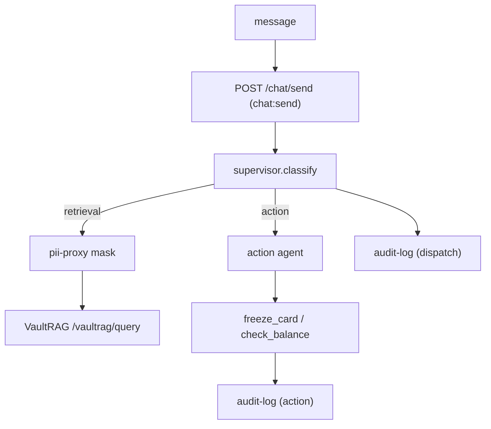

# AgentFlow

A multi-agent assistant for customer support and operations. A supervisor
classifies each request and routes it to a specialized agent with bounded
authority; the retrieval agent answers from the ingested documents (via
VaultRAG), the action agent performs sub-keyed operations, and every dispatch
and action is recorded in the tamper-evident audit log.

## How it works



### Routing — deterministic, no model

`supervisor.classify` maps a message to an intent with a keyword map:
`freeze`/`block`/`dispute`/`fraud`/`balance`/… → `action`, everything else →
`retrieval`. Routing is deterministic on purpose: it has no injection surface
and is fully testable.

### The retrieval agent — delegates to VaultRAG

The retrieval agent is a thin client: it masks the question through `pii-proxy`
(defense in depth) and calls VaultRAG's `/vaultrag/query`, forwarding the
caller's own bearer token. VaultRAG verifies the token, requires `vaultrag:query`,
and returns an answer with citations.

### The action agent — sub-keyed operations

The action agent runs bounded operations keyed by the authenticated `sub`:

| Tool | What it does |
| --- | --- |
| `check_balance` | returns the caller's own balance |
| `freeze_card` | freezes the caller's own card |

Because every operation is keyed by the JWT `sub`, a caller can never touch
another user's account — a message naming another user is ignored.

### Agents and bounded authority

| Agent | Scope | Behavior |
| --- | --- | --- |
| retrieval | `agent:retrieve` | mask → VaultRAG → cited answer |
| action | `agent:action` | `freeze_card` / `check_balance` |

A dispatch is refused with 403 if the token lacks the required scope.

## API

- `POST /chat/session` — login → scoped JWT
- `POST /chat/send` — `{message}` → `{sub, scopes, intent, agent, result, status}`
- `503 vaultrag_unavailable` — when VaultRAG cannot serve a retrieval request

## Modules

| Module | What it does |
| --- | --- |
| `supervisor.py` | deterministic classify + dispatch + scope enforcement |
| `agents.py` | retrieval (VaultRAG) and action agents |
| `tools.py` | sub-keyed `AccountService` (balance + freeze) |
| `pii_client.py` | HTTP client for `pii-proxy` |
| `vaultrag_client.py` | HTTP client for `VaultRAG` (forwards the bearer token) |
| `audit_client.py` | HTTP client for `audit-log` |
| `auth_client.py` | session issuance + JWKS-cached token verification |
| `deps.py` | bearer auth + scope enforcement |
| `settings.py` | typed config (`AGENTFLOW_` env prefix) |
| `api.py` | FastAPI app with injectable dependencies |

## Config

| Env | Default |
| --- | --- |
| `AGENTFLOW_AUTH_SERVICE_URL` | `http://localhost:8000` |
| `AGENTFLOW_AUDIT_LOG_URL` | `http://localhost:8101` |
| `AGENTFLOW_PII_PROXY_URL` | `http://localhost:8002` |
| `AGENTFLOW_VAULTRAG_URL` | `http://localhost:8003` |

## Run

```bash
uv pip install -e apps/agentflow
make demo   # integrated VaultRAG + AgentFlow demo (needs Ollama running)
```

## Tested invariants

`tests/acceptance/test_us_a2.py` proves:

- retrieval routes to VaultRAG, masks PII first, and forwards the caller's token
- freeze routes to the action agent and writes `agentflow.action`
- a token without the agent's scope is rejected with 403
- `check_balance` returns the caller's own balance and never leaks another user's
- VaultRAG down → 503 `vaultrag_unavailable`

`tests/unit/` covers the classifier, the sub-keyed `AccountService`, and the
supervisor dispatch.

## Out of scope (next)

- Delegated short-lived agent tokens
- SCA / TOTP for high-value actions
- Persistence (Postgres)
