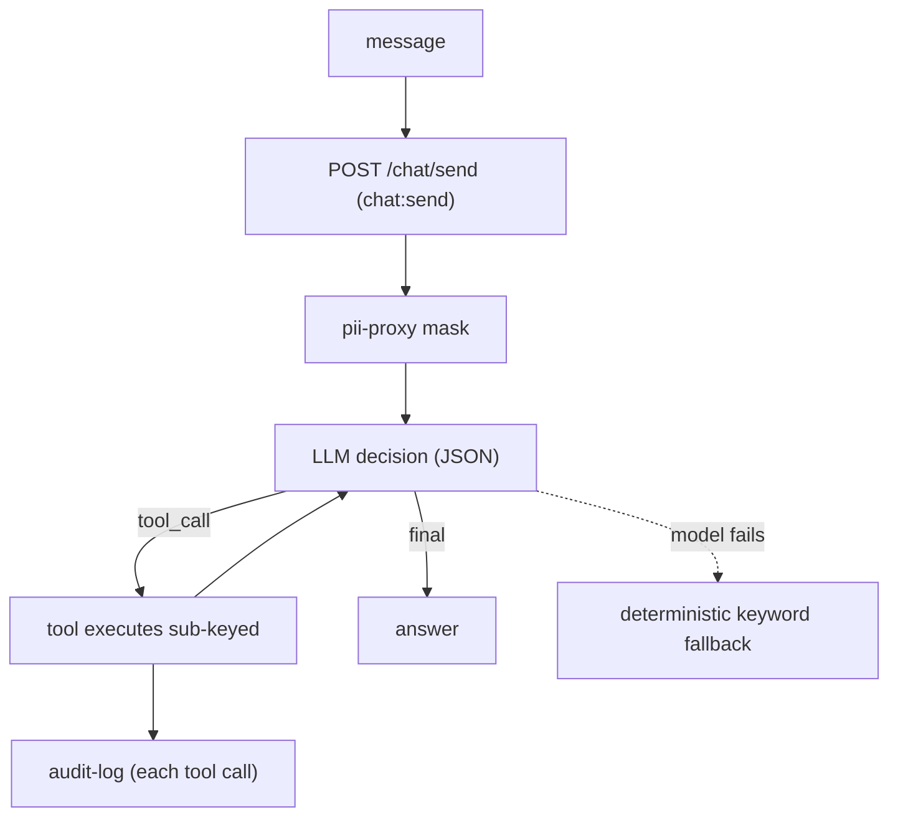

# AgentFlow

A multi-agent AI assistant for customer support and operations. An LLM-driven
agent loop classifies each request, selects a tool from a fixed allowlist, and
executes it sub-keyed and audited — with a deterministic keyword fallback if the
model is unavailable.

## How it works



### The LLM agent loop

`agent.Agent.run` masks the message, then loops (up to 3 steps): the model
returns a structured decision (`tool_call` or `final`), validated against a
Pydantic `Literal` allowlist. A tool call executes sub-keyed; its result feeds
back to the model until it produces a `final` answer.

### Tools (the allowlist)

| Tool | Scope | Behavior |
| --- | --- | --- |
| `retrieve` | `agent:retrieve` | delegate to VaultRAG (cited answer) |
| `freeze_card` | `agent:action` | sub-keyed |
| `check_balance` | `agent:action` | sub-keyed |

The model selects the tool, never its arguments: every tool is keyed by the JWT
`sub`, so the model cannot inject a target account. A token without the tool's
scope is refused with 403.

### Fallback

If the model is unavailable or its output is malformed at the first step, the
deterministic keyword classifier (`supervisor.py`) takes over, so the support
path keeps working.

## API

- `POST /chat/session` — login → scoped JWT
- `POST /chat/send` — `{message}` → `{sub, scopes, intent, agent, answer, result, steps, fallback, status}`
- `503 vaultrag_unavailable` — when VaultRAG cannot serve a retrieval request

## Modules

| Module | What it does |
| --- | --- |
| `agent.py` | the LLM-driven loop: mask → decide → validate → execute → audit |
| `llm.py` | Ollama chat client + `AgentDecision` (Pydantic allowlist) + JSON parse |
| `supervisor.py` | deterministic keyword classifier (the fallback) |
| `agents.py` | retrieval (VaultRAG) and action agents (fallback + tool impl) |
| `tools.py` | sub-keyed `AccountService` (balance + freeze) |
| `pii_client.py` | HTTP client for `pii-proxy` |
| `vaultrag_client.py` | HTTP client for `VaultRAG` (forwards the bearer token) |
| `audit_client.py` | HTTP client for `audit-log` |
| `auth_client.py` | session issuance + JWKS-cached token verification |
| `deps.py` | bearer auth + scope enforcement |
| `settings.py` | typed config (`AGENTFLOW_` env prefix) |
| `api.py` | FastAPI app with injectable dependencies |

## Config

| Env | Default |
| --- | --- |
| `AGENTFLOW_AUTH_SERVICE_URL` | `http://localhost:8000` |
| `AGENTFLOW_AUDIT_LOG_URL` | `http://localhost:8101` |
| `AGENTFLOW_PII_PROXY_URL` | `http://localhost:8002` |
| `AGENTFLOW_VAULTRAG_URL` | `http://localhost:8003` |
| `AGENTFLOW_OLLAMA_URL` | `http://localhost:11434` |
| `AGENTFLOW_LLM_MODEL` | `deepseek-v4-pro:cloud` |

## Run

```bash
uv pip install -e apps/agentflow
make demo   # integrated VaultRAG + AgentFlow demo (needs Ollama running)
```

## Tested invariants

- the loop drives tool selection and re-reasons with tool results (`test_agent.py`)
- the JSON output is validated against the allowlist (`test_llm.py`)
- a token without the tool's scope is rejected with 403
- `check_balance` is sub-keyed and never leaks another user's balance
- the model never sees raw PII (masked first)
- a repeated tool call is refused explicitly, never looped to the cap
- a generated answer with a canary/leak is blocked and audited (`guardrail`)
- VaultRAG down → 503 `vaultrag_unavailable`
- an LLM failure falls back to the keyword classifier

## Out of scope (next)

- SCA / TOTP for high-value actions
- Persistence (Postgres)
