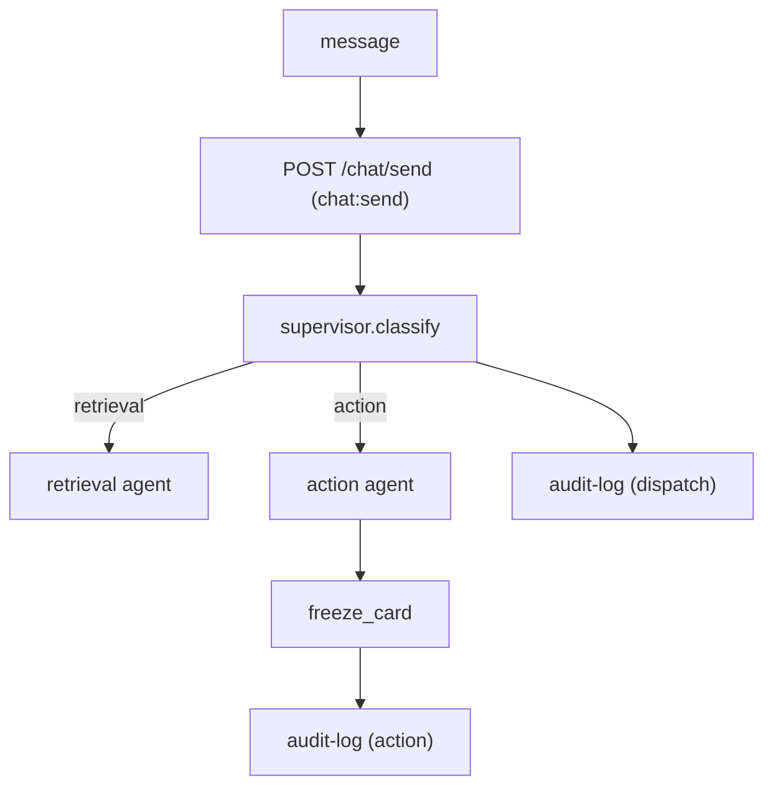

# AgentFlow

A multi-agent assistant for customer support and operations. A supervisor
classifies each request and routes it to a specialized agent with bounded
authority; every dispatch and action is recorded in the tamper-evident audit log.

## How it works



### Routing — deterministic, no model

`supervisor.classify` maps a message to an intent with a keyword map:
`freeze`/`block`/`dispute`/`fraud`/… → `action`, everything else → `retrieval`.
Routing is deterministic on purpose: it has no injection surface and is fully
testable. The LLM enters later, inside an agent, behind the pii-proxy.

### Agents and bounded authority

Each agent declares `required_scopes`; a dispatch is refused with 403 if the
caller's token does not carry them.

| Agent | Scope | Tools |
| --- | --- | --- |
| retrieval | `agent:retrieve` | none (read-only knowledge base) |
| action | `agent:action` | `freeze_card` |

### The action — freeze_card

The action agent runs exactly one bounded operation: freeze the caller's primary
card. It is in-memory for now; the `run` interface is what a real ledger-backed
action will also implement. This is the action SCA (TOTP) will later guard.

## API

- `POST /chat/session` — login → scoped JWT (existing)
- `POST /chat/send` — `{message}` → `{sub, scopes, intent, agent, result, status}`

## Modules

| Module | What it does |
| --- | --- |
| `supervisor.py` | deterministic classify + dispatch + scope enforcement |
| `agents.py` | retrieval and action agents |
| `tools.py` | the bounded `freeze_card` tool |
| `audit_client.py` | HTTP client for `audit-log` |
| `auth_client.py` | session issuance + JWKS-cached token verification (existing) |
| `deps.py` | bearer auth + scope enforcement (existing) |
| `settings.py` | typed config (`AGENTFLOW_` env prefix) |
| `api.py` | FastAPI app with injectable dependencies |

## Config

| Env | Default |
| --- | --- |
| `AGENTFLOW_AUTH_SERVICE_URL` | `http://localhost:8000` |
| `AGENTFLOW_AUDIT_LOG_URL` | `http://localhost:8101` |

## Run

```bash
uv pip install -e apps/agentflow
make demo-agentflow   # starts auth + audit + agentflow, routes two messages, shows the 403
```

## Tested invariants

`tests/acceptance/test_us_a2.py` proves:

- a retrieval message routes to the retrieval agent and writes `agentflow.dispatch`
- a freeze message routes to the action agent, executes `freeze_card`, and writes
  `agentflow.action`
- a token without the agent's scope is rejected with 403

`tests/unit/` covers the classifier (keyword map) and the `freeze_card` tool.

## Out of scope (next)

- LLM answer generation (behind pii-proxy)
- Delegated short-lived agent tokens
- SCA / TOTP for high-value actions
- Persistence (Postgres)
