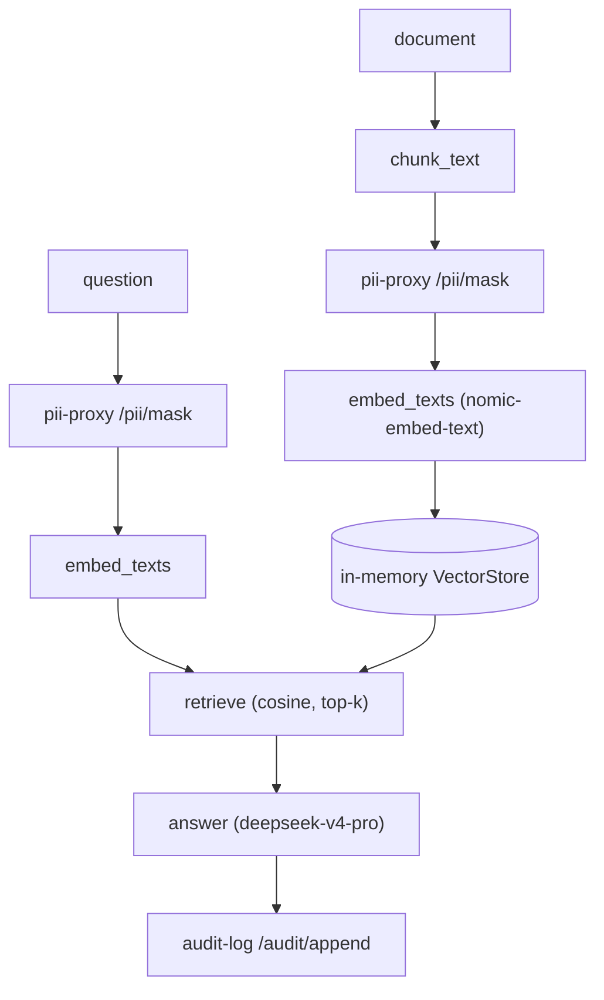

# VaultRAG

Secure retrieval-augmented generation over internal documents, for compliance
and AML analysts. Ask a question, get an answer with citations — and PII is
redacted before it ever reaches the model.

## How it works

Two endpoints drive the whole flow.



### Ingest — `POST /vaultrag/documents`

1. `chunker.chunk_text` splits the document into fixed-size windows with a
   character overlap, so a fact split across a boundary stays retrievable.
2. `clients.PiiClient.mask` sends each chunk to `pii-proxy`, which replaces PII
   with placeholders (`[IBAN]`, `[EMAIL]`, …).
3. `embeddings.embed_texts` embeds each redacted chunk with `nomic-embed-text`.
4. `store.VectorStore` keeps the redacted text, vector, and metadata.

Redaction happens **before** embedding, so raw PII never enters the store.

### Query — `POST /vaultrag/query`

1. Mask the question through `pii-proxy`.
2. Embed the masked question.
3. `retriever.retrieve` ranks every chunk by cosine similarity and keeps top-k.
4. `llm.answer` asks the model to answer only from the context and cite by number.
5. `clients.AuditClient.append` writes the query to `audit-log` — a hash of the
   question, the retrieved chunk ids, and a hash of the answer, never the raw text.

## Modules

| Module | What it does |
| --- | --- |
| `chunker.py` | split text into overlapping windows |
| `embeddings.py` | call the Ollama embeddings API |
| `retriever.py` | cosine similarity + top-k |
| `store.py` | in-memory `Chunk` + `VectorStore` |
| `llm.py` | grounded answer via the Ollama chat API |
| `clients.py` | HTTP clients for `pii-proxy` and `audit-log` |
| `auth.py` | scoped JWT verification (`vaultrag:ingest` / `vaultrag:query`) |
| `settings.py` | typed config (`VAULTRAG_` env prefix) |
| `api.py` | FastAPI app with injectable dependencies |

Every dependency (`store`, `pii`, `audit`, `embed`, `llm`) is injectable, so the
security invariants are testable without a running model.

## Run

```bash
uv pip install -e apps/vaultrag
make demo   # starts services, ingests sample docs, runs three queries
```

Needs Ollama running with `nomic-embed-text` and the configured chat model.

## Config

| Env | Default |
| --- | --- |
| `VAULTRAG_PII_PROXY_URL` | `http://localhost:8002` |
| `VAULTRAG_AUDIT_LOG_URL` | `http://localhost:8101` |
| `VAULTRAG_OLLAMA_URL` | `http://localhost:11434` |
| `VAULTRAG_EMBED_MODEL` | `nomic-embed-text` |
| `VAULTRAG_LLM_MODEL` | `deepseek-v4-pro:cloud` |
| `VAULTRAG_CHUNK_SIZE` | `500` |
| `VAULTRAG_CHUNK_OVERLAP` | `50` |
| `VAULTRAG_TOP_K` | `4` |
| `VAULTRAG_AUTH_SERVICE_URL` | `http://localhost:8000` |

Both endpoints require a scoped JWT: ingest requires `vaultrag:ingest`, query
requires `vaultrag:query`. Tokens are verified locally against the auth-service
JWKS.

## Tested invariants

`tests/acceptance/test_vaultrag.py` proves:

- ingest redacts PII before it is embedded,
- query returns an answer and citations,
- query masks PII before the model and writes an audit record,
- a token without the required scope is rejected (401/403).

`tests/unit/` covers the chunker (overlap, empty input, bad overlap) and the
retriever (cosine similarity, top-k ordering).

## Out of scope (next)

- Postgres/pgvector persistence (in-memory today)
- Hybrid BM25 + dense retrieval
- Tenant (row-level) isolation
- PDF ingestion
