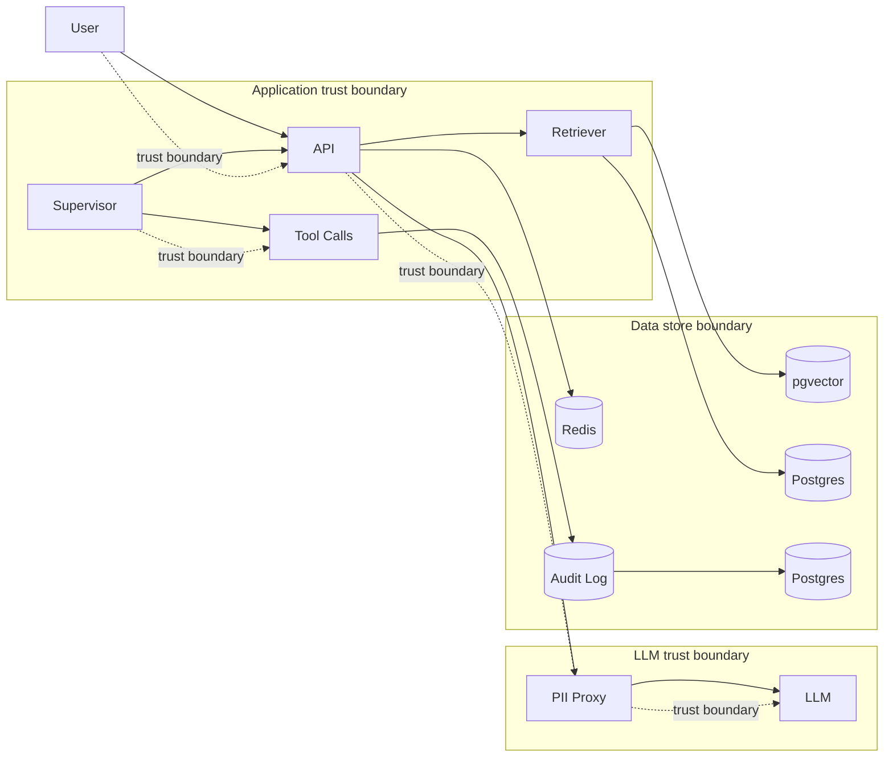

# Threat model v1

This is a draft threat model for the initial platform scope. It is intentionally explicit about what is planned versus implemented. This v1 document covers the first shared-control architecture between VaultRAG, AgentFlow, and the append-only audit service; it does not yet claim production-grade controls for authentication, key management, or a blockchain anchor.

## 1. System overview

VaultRAG is the retrieval layer used by compliance analysts to search internal policies and document stores while minimizing the exposure of sensitive customer information. It passes retrieved context to a model, which creates an LLM-facing trust boundary between external user intent and internal policy data. The main design concern is indirect prompt injection via retrieved content and extraction of model behavior via API scraping.

AgentFlow is the orchestration layer for support workflows that call tools and agents under supervision. It coordinates multi-step interactions, orchestrates tool execution, and composes LLM reasoning with operational actions. The key design concern is indirect injection through tool outputs and the confused-deputy problem when a tool call is authorized on behalf of the wrong principal.

Shared services include the audit log, logging, settings, and tracing primitives used by both apps. The audit log is intentionally outside the app logic so it can serve as a single source of truth for who performed sensitive actions and whether the record set was tampered with. The initial service does not yet enforce external mTLS or authorisation; that is planned in W2/W7.

## 2. Data flow diagram

## 3. Asset inventory

| Asset | Sensitivity | Owner | Where stored | Encryption at rest | Access control |
| --- | --- | --- | --- | --- | --- |
| Customer support transcripts | High | Product | Postgres | Planned | RBAC + audit log |
| Retrieval documents | Medium | Compliance | pgvector | Planned | Tenant isolation |
| PII redaction configuration | High | Platform security | Postgres | Planned | Restricted |
| Audit records | High | Security | Postgres | Planned | DB immutability trigger |
| JWT signing keys | Critical | Platform security | KMS/secret store | Planned | Restricted to auth service |
| LLM prompts and tool outputs | High | Product | Postgres/Redis | Planned | Scoped per tenant |
| Payment metadata | Critical | Finance | Postgres | Planned | Strong RBAC and audit trail |

## 4. STRIDE table

| Component | S | T | R | I | D | E | Mitigations planned (story ID) |
| --- | --- | --- | --- | --- | --- | --- | --- |
| VaultRAG retriever |  | X | X | X |  | X | US-V6 audit log; W5 evals |
| AgentFlow supervisor | X | X | X | X | X | X | W3 tool governance; US-V6 |
| PII proxy |  | X |  | X |  | X | W2, W5 |
| Audit log | X | X | X | X | X | X | US-V6; W7 Merkle anchor |
| JWT auth | X | X |  | X |  | X | W2 |
| Tool execution layer | X | X | X | X | X | X | W3 tool governance; US-V6 |
| Postgres / pgvector | X | X | X | X | X | X | US-V6 immutability trigger; W7 KMS |

## 5. Attack surface per component

- VaultRAG retriever
  - Indirect prompt injection via retrieved documents (OWASP LLM 01; MITRE ATLAS AML.T0051)
  - Model extraction via API scraping and repeated probing (OWASP LLM 02; MITRE ATLAS AML.T0011)
  - Tenant bleed via similarity search or index poisoning (OWASP LLM 10; MITRE ATLAS AML.T0008)

- AgentFlow supervisor
  - Indirect injection via tool outputs (OWASP LLM 01; MITRE ATLAS AML.T0051)
  - Confused deputy in agent tool calls (OWASP LLM 05; MITRE ATLAS AML.T0008)
  - Tool abuse and prompt override by malicious downstream data (OWASP LLM 04)

- PII proxy
  - PII leakage via LLM context or prompt assembly (OWASP LLM 06; GDPR Art. 17)
  - Incomplete redaction causing protected data to cross trust boundaries

- Audit log
  - Audit log tampering or update/delete by a privileged user (US-V6; DORA Art. 8)
  - Loss of append-only guarantee via a dropped DB trigger (W7 config-as-code review)

- JWT auth
  - Signing key compromise (W2)
  - Replay or token forgery if trust anchors are misconfigured
  - JWT alg confusion (`HS256`/`none`) causing a verifier to accept a malicious token (AUTH-1; mitigated by `test_alg_confusion.py`)
  - Expiry bypass or stale token acceptance if `exp` and `aud` validation are not enforced (AUTH-1; mitigated by required `exp` + `aud` checks)
  - mTLS cert spoofing between internal services (W7)

- Token replay / session hijack
  - Reuse of a leaked bearer token outside the intended session or without a fresh nonce (known gap until US-A3; `jti` is recorded but not yet enforced)

## 6. Regulatory mapping

| Threat | Relevant regulation |
| --- | --- |
| PII leakage via LLM context | GDPR Art. 17, GDPR Art. 30 |
| Audit log tampering | DORA Art. 8, AMLD Art. 40 |
| Payment replay / double-charge | PSD2 Art. 97 |
| Dangerous model output or manipulative system behavior | EU AI Act Art. 50 |
| Lack of records of processing | GDPR Art. 30 |

## 7. Open questions

- How do we validate a vendor KMS policy for JWT signing keys and service certificates?
- How do we enforce tenant-specific retention schedules for sensitive documents and logs?
- What service-to-service trust model will be required for production mTLS and mutual certificate validation?
- How do we enforce `jti` replay checks and session binding during US-A3 without bypassing the current short-lived JWT model?
- Which data elements require explicit DPO review before LLM processing starts?
- How do we operationalize a DB trigger change review so it cannot silently be dropped by a privileged DBA?

This is a draft. The mitigations marked as planned are not yet production controls; only those tied to a story ID and a test are treated as implemented controls.
