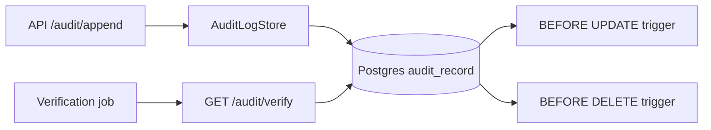

# Audit log service

This service is the shared tamper-evident ledger for the fintech platform. It is intentionally not an app-specific module because both VaultRAG and AgentFlow need trustworthy records for user actions, retrieval decisions, and tool executions.

## Current story

- US-V6: append-only, tamper-evident audit log

## Architecture

## Data model

The canonical table is:

- `id` UUID primary key
- `seq` BIGINT unique, monotonic
- `timestamp` TIMESTAMPTZ
- `actor_sub` TEXT
- `tenant_id` TEXT
- `action` TEXT
- `payload` JSONB
- `payload_hash` TEXT
- `prev_hash` TEXT
- `hash` TEXT
- `retention_until` TIMESTAMPTZ

Each row is chained with the previous hash, and the record hash is computed as:

`sha256(prev_hash + canonical_json(record_without_hash))`

## Runbook

### How to ingest

- Call `POST /audit/append` with a record payload.
- The service computes the payload hash and the chain hash.
- The DB row is stored with a strictly increasing `seq`.

### How to run verification

- Call `GET /audit/verify`.
- A valid result is `{"valid": true, "count": N, "first_broken_at": null}`.
- A broken chain returns the index of the first inconsistent row.

### How to handle a broken chain

1. Freeze writes to the audit log.
2. Export the offending window and compare chain hashes.
3. Investigate whether a DB change or application bug caused the break.
4. Rehydrate the chain from the last valid record before resuming collection.

### How to add a Merkle batch later

- Collect hash-chain records into a rolling batch.
- Publish the Merkle root to an external verifier or blockchain anchor in W7.
- Keep the per-row hash chain as the local forensic source of truth.

## Known limitations

- No auth yet (tracked in W2)
- No blockchain anchor yet (tracked in W7)
- No retention purge job yet (tracked in W7)
- No external mTLS enforcement yet (v1 trusts localhost only)
